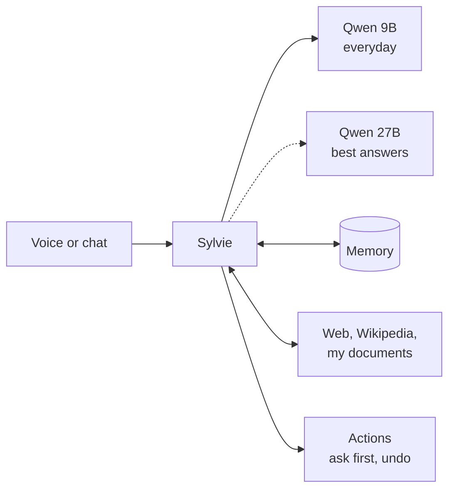

# Sylvie

**Work in progress:** I started Sylvie in November 2026 and I'm still building her.

Sylvie is my personal AI assistant. She runs completely on my laptop, so nothing personal goes to the cloud. I wanted an assistant that knows me, speaks my three languages, and that I can train myself.

The code is private because it's connected to my own data (my memory, documents and conversations), but I'm happy to show it and explain how it works.

## What she can do now

- Talk by voice in English, Spanish and French, and start answering as soon as the first sentence is ready
- Remember what I tell her, and forget it when I ask
- Search the web privately, a local copy of Wikipedia and my own documents, and show where the answer came from
- Use my calendar, reminders, email and Spotify. She always asks before doing something, and I can undo it
- Work from a menu bar app on my Mac, and from my iPhone

## How she's built

She uses open-source Qwen models through Apple's MLX: a 9B model for everyday chat, and a 27B model when I want the best answers. Everything runs on my MacBook Pro (M5 Max, 36 GB).

## Training her

This is the part I've enjoyed the most. I built my own pipeline to fine-tune the model with LoRA:

1. A dataset builder that only uses licensed data and keeps my personal data out
2. Training at night
3. Six test sets that she's never trained on: maths, finance, languages, tool use, general knowledge and style
4. A new version only replaces the old one if it doesn't get worse on any test

At night, a second model also reviews her answers and suggests better ones for me to check.

**My latest version of the 27B (v004):**

| Test | Score |
|---|---|
| Maths | 25/25 |
| Finance | 14/14 |
| Languages | 10/10 |
| Tool use | 9/9 |
| General knowledge | 8/8 |
| Style | went from 4/12 to 6/12 |

**Speed on my laptop (27B):** about 25 tokens per second. In a long chat, the next answer starts in about 0.2 s instead of 14 s, because I reuse the earlier part of the conversation (prompt caching). By voice, she starts speaking 0.8 to 1.5 s after I stop talking.

## Problems I ran into

- **My first training runs crashed.** The loss kept turning into NaN. It took me a while to find out why: some examples were cut at 512 tokens before the answer even started, so there was nothing to learn and the whole run broke. Now every example is measured with the real tokenizer before training.
- **Not enough memory.** Training the 27B needs about 38.5 GB and my laptop has 36, so it runs at night in small steps that can resume if something fails.
- **Too slow.** With my other apps open, the 27B slowed down a lot, so day to day she now uses the 9B.

## What I'm working on next

- Several agents that plan, act and check each other's work
- Learning regularly from my feedback
- A body: a small rolling robot with a camera, a screen and a voice, with Sylvie as its brain

## Built with

Python, FastAPI, Apple MLX, Qwen, LoRA/QLoRA, Whisper, Kokoro, SQLite, SearXNG, Swift/SwiftUI, Tailscale
