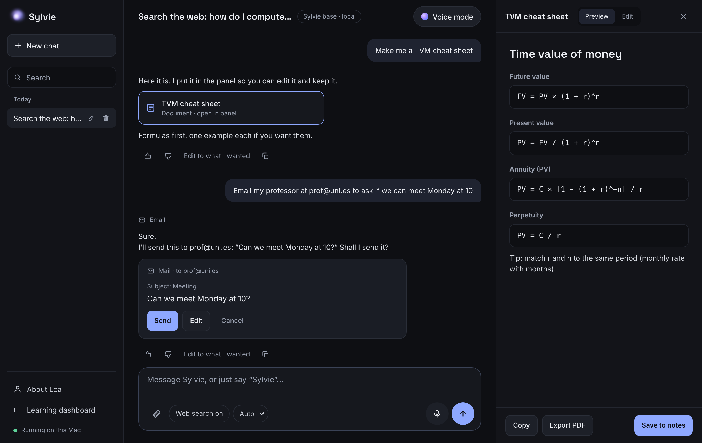
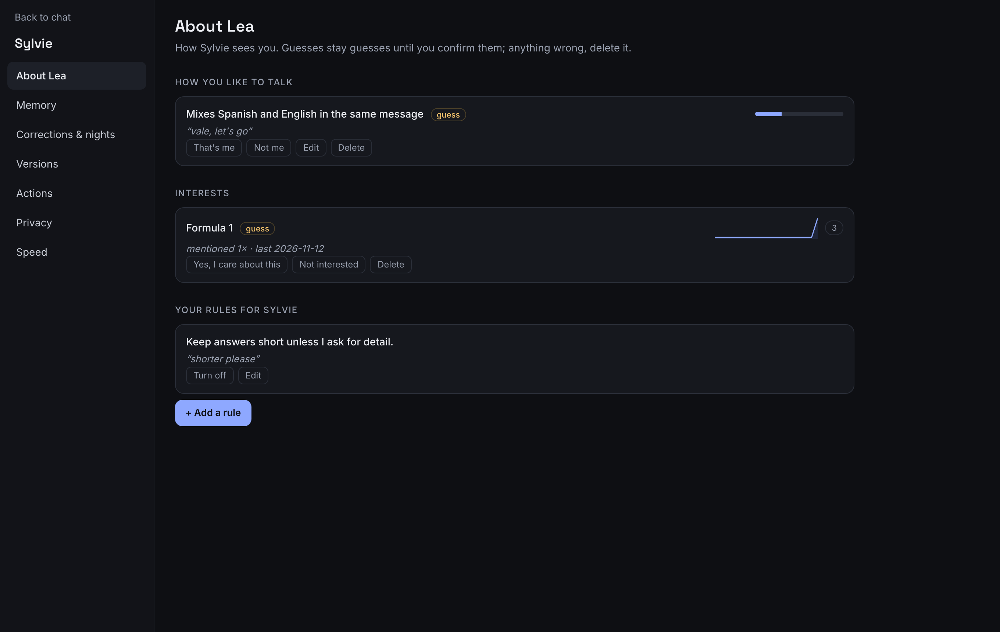
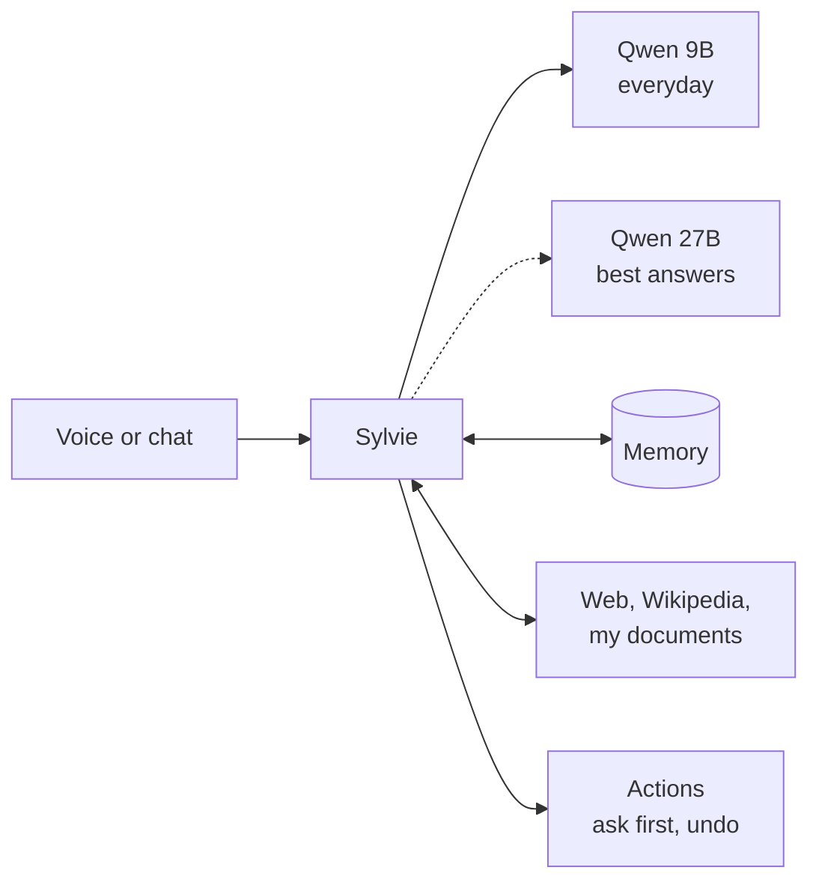

# Sylvie

Sylvie is my personal AI assistant. She runs completely on my laptop, so nothing personal goes to the cloud. I wanted an assistant that knows me, speaks my three languages, and that I can train myself.



<sub>Screenshot from the UI dev server (`scripts/ui_dev.py`): the real interface with a scripted fake model and a throwaway database.</sub>

> Status: I started Sylvie in November 2026 and I use her every day. 387 tests, lint clean. She's built for one person (me), so "Lea" appears throughout the code; making her work for anyone is the next big step.

**See the interface without downloading a model:**

```bash
uv sync
uv run python scripts/ui_dev.py     # then open http://127.0.0.1:8766/auth?t=dev
```

---

## What she can do now

- Talk by voice in English, Spanish and French, and start answering as soon as the first sentence is ready
- Remember what I tell her, and forget it when I ask
- Search the web privately, a local copy of Wikipedia and my own documents, and show where the answer came from
- Use my calendar, reminders, email and Spotify. She asks before deleting or sending anything, and I can undo it
- Work from a menu bar app on my Mac, and from my iPhone



## How she's built



She uses open-source Qwen models through Apple's MLX: a 9B model for everyday chat, and a 27B model when I want the best answers. Everything runs on my MacBook Pro (M5 Max, 36 GB).

| Folder | What's in it |
|---|---|
| [`core/`](core) | the server, the orchestrator (one turn of conversation), intent routing, prompts |
| [`memory/`](memory), [`lea_profile/`](lea_profile) | what she remembers about me, with evidence and confidence |
| [`knowledge/`](knowledge), [`tools/`](tools) | web search (SearXNG), offline Wikipedia, my documents and Zotero |
| [`actions/`](actions) | calendar, mail, messages, music… with an allowlist, confirmations and undo |
| [`voice/`](voice) | Whisper for listening, Kokoro for speaking |
| [`learning/`](learning), [`evals/`](evals) | the fine-tuning pipeline and the test sets that gate it |
| [`app/`](app), [`ui/`](ui) | the SwiftUI menu bar app and the web interface |

## Training her

This is the part I've enjoyed the most. I built my own pipeline to fine-tune the model with LoRA:

1. A dataset builder that only uses licensed data and keeps my personal data out ([`learning/privacy.py`](learning/privacy.py) checks every example for my name, phone numbers and other personal terms)
2. Training at night, only when the Mac is plugged in and I'm not using it
3. Test sets that she's never trained on: maths, finance, languages, tool use, general knowledge and style ([`evals/sets/`](evals/sets))
4. A new version only replaces the old one if it doesn't get worse on any test ([`learning/promote.py`](learning/promote.py))

At night, a second model also reviews her answers and suggests better ones for me to check.

**My best version of the 27B (v004):**

| Test | Score |
|---|---|
| Maths | 25/25 |
| Finance | 14/14 |
| Languages | 10/10 |
| Tool use | 9/9 |
| General knowledge | 8/8 |
| Style | went from 4/12 to 6/12 |

**The gate doing its job.** My latest 9B adapter (v005) got better at style (7/12 → 9/12) but worse at maths (25 → 23/25), finance (14 → 10/14) and tool use (9 → 7/9). So it was not promoted, and Sylvie still runs on the base 9B. None of my 9 adapters has replaced the base model yet; the style set is small and noisy, so that's the next thing to fix.

**Tests drive the fixes too.** When she handled to-do requests badly, I wrote a 15-question set first: 3/15 before the fix, 15/15 after.

**Speed on my laptop (27B):** about 25 tokens per second. In a long chat, the next answer starts in about 0.2 s instead of 14 s, because I reuse the earlier part of the conversation (prompt caching). By voice, she starts speaking 0.8 to 1.5 s after I stop talking.

## Problems I ran into

- **My first training runs crashed.** The loss kept turning into NaN. It took me a while to find out why: some examples were cut at 512 tokens before the answer even started, so there was nothing to learn and the whole run broke. Now every example is measured with the real tokenizer before training.
- **Not enough memory.** Training the 27B needs about 38.5 GB and my laptop has 36, so it runs at night in small steps that can resume if something fails.
- **Too slow.** With my other apps open, the 27B slowed down a lot, so day to day she now uses the 9B.

## Privacy

- The server only listens on `127.0.0.1`; the iPhone reaches it through my private Tailscale network.
- [`config.yaml`](config.yaml) ships with **safe defaults**: personal sources (WhatsApp, Photos, Zotero, documents, Claude history) are off, Terminal commands are off, and she asks before deleting or sending. My own settings live in `config.local.yaml`, which is never committed.
- Personal data lives in `~/Library/Application Support/Sylvie`, outside the repo and outside iCloud.

## Run it

Apple Silicon Mac, Python 3.13 and [uv](https://docs.astral.sh/uv/).

```bash
make setup          # uv sync
make test           # 387 tests, offline, with a fake model
make download       # the 9B model, embeddings and voice (make download-27b for the larger model)
make run            # the server on 127.0.0.1:8765
make open           # open the chat
make app            # build the menu bar app
```

To change a setting, copy `config.yaml` to `config.local.yaml` and edit that. Model and dataset licenses are in [`docs/LICENSES.md`](docs/LICENSES.md).

## How I built it

I designed Sylvie and made the product calls; I built her with Claude Code as my pair programmer. Every technical decision is written down with what, why and the alternatives in [`docs/decisions.md`](docs/decisions.md).

## What I'm working on next

- Several agents that plan, act and check each other's work
- Learning regularly from my feedback
- A version anyone can set up for themselves, not just me
- A body: a small rolling robot with a camera, a screen and a voice, with Sylvie as its brain

## Built with

Python, FastAPI, Apple MLX, Qwen, LoRA/QLoRA, Whisper, Kokoro, SQLite, SearXNG, Swift/SwiftUI, Tailscale

[Lea Pessey Girod](https://github.com/lpesseygirod)
