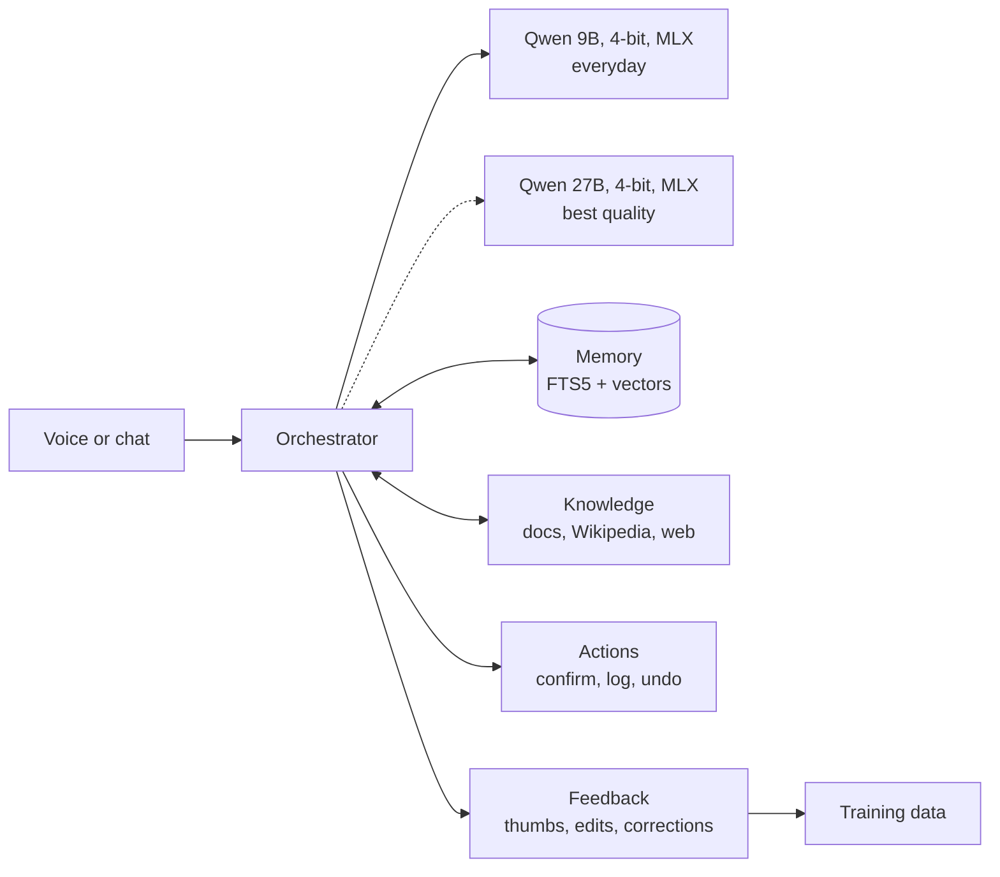
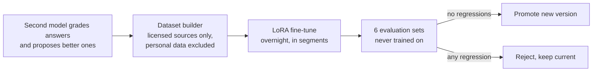

# Sylvie

**Work in progress.** I started Sylvie in November 2026 and I'm building her step by step. Everything under *What she can do* works today; *Next* is what I'm working on now.

**A personal AI assistant that runs entirely on my laptop.** Sylvie talks by voice in English, Spanish and French, remembers what I tell her, searches the web and my own documents, acts on my apps, and learns from my corrections. Nothing personal leaves the computer.

> The source code is private because it lives next to my personal data (memory, documents, conversations). This page describes the system, its design and its measured results. I'm happy to walk through the code in an interview.

## What she can do

- **Talk:** speech-to-text with Whisper large-v3-turbo (English, Spanish, French and mixed), spoken answers that start as soon as the first sentence is ready, a wake word, interruptions ("stop", "para", "arrête").
- **Remember:** facts and preferences pulled out of conversations, hybrid recall (SQLite FTS5 + sqlite-vec embeddings), contradictions handled (newer wins, history kept), and "forget that".
- **Look things up:** private web search through a local SearXNG, a local copy of Wikipedia (14.7M articles in three languages), and my own documents with citations.
- **Act:** Calendar, Reminders, Mail, Spotify, timers and Shortcuts. Every action asks first, is logged, and can be undone.
- **Everywhere:** a SwiftUI menu bar app on the Mac, and an iPhone gateway through Tailscale.

## How it works

Everything runs on an Apple M5 Max with 36 GB of shared memory: the server is local only (127.0.0.1), protected with a Keychain token, and all data lives outside synced folders.

## The learning loop

A version is promoted only if it scores at least as well as the current one on every evaluation set.

## Results

**Speed** (27B model, measured on the laptop)

| Measurement | Result |
|---|---|
| Generation speed | ~25 tokens/s |
| Follow-up turn in a 7k-token chat, with prompt caching | 0.21–0.27 s to first token (14 s without the cache) |
| Voice: end of speech to first speakable sentence | 0.8–1.5 s |

**Latest fine-tune of the 27B (v004)** compared with the base model

| Evaluation set | Score |
|---|---|
| Maths | 25/25 |
| Finance | 14/14 |
| Multilingual | 10/10 |
| Tool use | 9/9 |
| General knowledge | 8/8 |
| Style | 4/12 → 6/12 |

509 training examples, validation loss 1.27 → 0.90, no regressions.

## Problems I had to solve

- **Training runs that diverged (NaN).** Qwen's chat template adds ~290 tokens of tool instructions, so some examples were cut at the 512-token limit *before their answer*. They had zero target tokens, the loss became 0/0, and one step poisoned every weight. Fix: measure every example with the exact tokenizer, drop the ones that don't fit, and roll back automatically on NaN.
- **Memory limits.** Fine-tuning the 27B peaks at ~38.5 GB, more than the laptop has, so training runs overnight in resumable 100-step segments, on 512-token sequences and 8 LoRA layers.
- **Speed vs quality.** With other apps open, the 27B made the laptop swap (9–10 tokens/s), so everyday chat moved to a 9B model and a memory guard loads heavy models only when there's room.

## Next

- A multi-agent setup where specialised agents plan, act and check each other's work
- Regular self-learning from my feedback
- A physical body: a small rolling robot with a camera, a screen and a voice, with Sylvie as its brain

## Built with

Python · FastAPI · Apple MLX · Qwen 3.5/3.8 · LoRA/QLoRA · Whisper · Kokoro TTS · SQLite (FTS5, sqlite-vec) · SearXNG · Swift/SwiftUI · Tailscale
